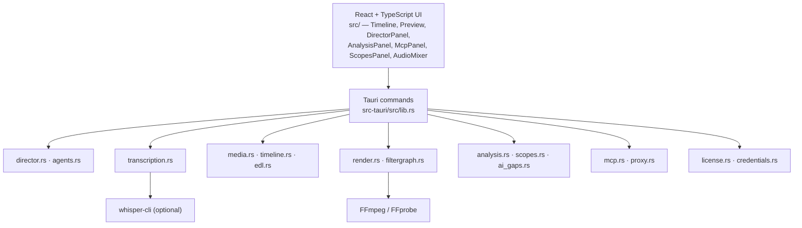

# StudioCut AI

[](https://github.com/alphaframehq/studiocut-ai/actions/workflows/ci.yml)
[](LICENSE)


A local-first video editor with an AI Director, built with React, TypeScript,
Rust and Tauri. Your media stays on your machine — originals are referenced
by path and fingerprint, never copied or uploaded. The AI Director and
transcription providers work with your own API keys (bring your own key);
there is no built-in key and no cloud account.

> **Status: v0.1.0 is in active development and has not been released.**
> No installers are published, and no release exists yet. The editor,
> timeline, transcription, AI Director and FFmpeg export are implemented,
> but the application has never been run on a real Windows, macOS or Linux
> desktop — native desktop qualification is still open. See
> [`PLAN.md`](PLAN.md) for the milestone record and its limits, and
> [Known limits](#known-limits) below for the honest list.

## Features

### Editing

- **Projects** — versioned `.studiocut` files (schema v1–v6), atomic
  save/reopen, 50-step session undo.
- **Media import** — FFprobe metadata, SQLite index, thumbnails, waveforms.
  Originals are referenced by path and fingerprint, never copied.
- **Timeline** — multi-track video, audio and caption editing: move, trim,
  split, ripple delete, mute/solo/lock, linked audio/video clips, zoom,
  speed 0.25–4×.
- **Preview** — real video preview driven by an audio-master clock (48 kHz).

### AI Director

- **Chat-to-Edit** — describe the edit in plain language; the Director
  proposes one JSON edit decision list (maximum 64 operations), which you
  review and approve before anything touches the timeline. Every applied
  proposal is one undo checkpoint.
- **Bring your own key** — 9 providers (Gemini, OpenAI, Claude, Groq,
  OpenRouter, OpenAI-compatible, Ollama, Bedrock, Vertex). Keys are stored
  in the operating-system credential manager or session-only memory, never
  in project files. Environment-variable fallback is supported for the
  main providers (see [Settings](#settings)).

### Transcription and analysis

- **Silence detection** (50 ms RMS) and local Whisper transcription via
  `whisper-cli`, or bring-your-own-key cloud transcription.
- **Kinetic captions** in 4 presets (Hormozi, Minimal, Documentary, Neon).
- **Shot detection** uses a brightness/texture heuristic — not machine
  learning and not face detection.
- **Speaker diarization, music beat detection and auto-reframe are
  heuristics, not models.** Diarization produces pause-based speaker-turn
  hints from word timestamps; beat detection uses energy-based onset
  detection; reframe computes a centre crop with no face tracking. No
  diarization or beat model is bundled. See `src-tauri/src/ai_gaps.rs`.

### MCP

- **Model Context Protocol client** — connect external MCP servers with
  your own server URL and credentials, so MCP tools can feed the Director.
  MCP servers are bring-your-own; none is bundled or hosted by StudioCut AI.

### Scopes, mixer and proxy

- **Video scopes** are a grading aid. Every scope is an approximation of
  the full-resolution frame — the UI always shows the approximation notice.
  See `src-tauri/src/scopes.rs`.
- **Audio mixer** — per-track mixing controls in the studio panel.
- **Proxy editing** — a toggle for lighter proxy previews while editing.

### Finishing and export

- Color grading, LUTs (`.cube`), audio mastering with ducking.
- Deterministic FFmpeg export (MP4/MOV, 1080p/4K, 24/30/60 fps) with
  progress, cancel, FFprobe validation and atomic publish. Existing files
  are never overwritten.
- **License gate** — an offline Ed25519 license, bound to the machine
  fingerprint. It gates only AI Director proposals and export; editing,
  import and transcription work unlicensed. Development builds bypass
  the gate.

## Architecture



The frontend talks to Rust only through Tauri commands. All editing,
rendering and analysis decisions live in the Rust backend; the UI holds
presentation state.

## Screenshots

There are no screenshots yet. The application has never run on a real
desktop, so no screenshot of the running app exists, and none is shown
here rather than a mock-up presented as the real thing. A clickable UI
preview mock-up exists separately from this repository; it is a design
preview, not the running application.

## Requirements

| Piece | Why | Install |
|---|---|---|
| Node.js 24 (CI) / recent LTS + npm | Frontend development and build | Node.js installer or package manager |
| Rust 1.90 | Tauri backend | rustup |
| `ffmpeg` + `ffprobe` v6+, with libass + libx264 | Import, preview audio, export | See [`SETUP_BINARIES.md`](SETUP_BINARIES.md) |
| `whisper-cli` + GGML `.bin` model (optional) | Local transcription | See [`SETUP_BINARIES.md`](SETUP_BINARIES.md) |

FFmpeg location: on `PATH`, or point at it explicitly — the backend
honours `FFMPEG_PATH` and `FFPROBE_PATH` (full path to the binary).
Release builds are being prepared to bundle FFmpeg and FFprobe as
sidecars so no separate install is needed; until a release ships, a
source build needs FFmpeg + FFprobe on `PATH` (or via those variables).
Without FFmpeg, import and export fail with a clear error; the editor
UI still opens.

## Setup and run

```bash
npm install
npm run dev          # web preview only (port 3000; Tauri features disabled)
npm run tauri dev    # full desktop app (dev build: license gate bypassed)
npm run build        # tsc + vite build
npm run tauri build  # release desktop build (license-gated; builds the installer for the host OS)
```

### Project format

StudioCut AI projects are `.studiocut` files (JSON, schema v1–v6). The
application upgrades older schemas on open and saves atomically. There
is no autosave yet — save explicitly.

## Settings (in-app, Settings button)

- **API keys** — the 9 providers listed above. Environment-variable
  fallback: `OPENAI_API_KEY`, `ANTHROPIC_API_KEY`, `GEMINI_API_KEY`,
  `GROQ_API_KEY`, `OPENROUTER_API_KEY`, `AWS_BEARER_TOKEN_BEDROCK`,
  `VERTEX_ACCESS_TOKEN`.
- **AI & encoding** — preferred encoder (Auto / libx264 / NVENC /
  VideoToolbox / AMF / QSV). It is the default in the Export dialog;
  hardware candidates are probe-checked and fall back to libx264 with a
  disclosure.
- **Transcription** — `whisper-cli` path/command and GGML model path.
  Saved persistently and shared with the Analysis panel.
- **My style** — one saved look and pace (caption preset, export aspect,
  frame fill, pace, intro style, music mood) applied to export and
  captions.
- **License** — paste a `base64payload.signature` license file to
  activate.

## Release

### Installers

`npm run tauri build` builds the installer for the host operating system
only: `.deb` on Linux, NSIS/MSI on Windows, `.dmg` on macOS. Build each
platform on its native operating system (or in CI, one job per operating
system); cross-platform installer builds are not supported. The bundle
targets are configured in `src-tauri/tauri.conf.json` (`deb`, `nsis`,
`msi`, `dmg`). No code-signing identity or certificate is configured in
this repository: before distributing a build, sign it with the platform
identity (Apple Developer ID with notarization on macOS; a code-signing
certificate on Windows) and record the identity used.

**No installers have been published.** v0.1.0 is unreleased, and there is
no download link.

### Issuing a license

Release builds require an offline Ed25519 license signed by the vendor
key; development builds bypass the gate. Licenses are issued with the
`license-tool` binary (`src-tauri/src/bin/license-tool.rs`):

```bash
cargo run --locked --release --bin license-tool -- generate-key
cargo run --locked --release --bin license-tool -- issue --seed <hex-seed> --name "Jane Doe" --email jane@example.com --fingerprint <machine-fingerprint> --expires never
cargo run --locked --release --bin license-tool -- verify --license <license-text> --fingerprint <machine-fingerprint> --public-key <hex-public-key>
```

`generate-key` prints a new private seed and the matching public key.
Store the private seed offline and never commit it. Paste the printed
public key into `LICENSE_PUBLIC_KEY` in `src-tauri/src/license.rs` and
rebuild before issuing licenses with the new key; licenses signed with a
previous key stop verifying after the public key is replaced, so plan key
rotation before any public release. The machine fingerprint is shown in
the application under Settings › License; a license is bound to that
single machine. `--expires` accepts `never` or a Unix timestamp in
seconds. On Windows, `generate-key` needs `--seed` with 32 random bytes
(for example from `openssl rand -hex 32`); on Linux and macOS it reads
`/dev/urandom`.

### Updates

The updater is configured in `src-tauri/tauri.conf.json` under
`plugins.updater`, with the real public key and the GitHub Releases
endpoint (`https://github.com/alphaframehq/studiocut-ai/releases/latest/download/latest.json`),
and `bundle.createUpdaterArtifacts` is enabled. The updater plugin is
wired into the build (`tauri-plugin-updater` in `src-tauri/Cargo.toml`,
registered in `src-tauri/src/main.rs`, capability granted in
`src-tauri/capabilities/main.json`). The private signing key is supplied
as the `TAURI_SIGNING_PRIVATE_KEY` environment variable at build time;
never commit it. **No update has ever been served**, because no release
exists yet — the first published update, with its signature verified by
a fresh install, is still to be done.

### Still manual before release

- Desktop verification on real Windows, macOS, and Linux hardware
  (install, launch, license activation, Director, export).
- Code signing and, on macOS, notarization.
- The first published update served from the real update endpoint, with
  the signature verified by a fresh install.

## Tests

Continuous integration (`.github/workflows/ci.yml`) is the source of
truth: frontend build, Rust formatting, and the Rust test suite on
`ubuntu-latest`. `cargo test` cannot run on a minimal Linux VM without
the Tauri system libraries and FFmpeg installed.

```bash
npm run build
cargo test --locked --manifest-path src-tauri/Cargo.toml
cargo fmt --manifest-path src-tauri/Cargo.toml -- --check
```

115 test functions are in the tree on this commit (63 unit tests in
`src-tauri/src/`, 52 integration tests in `src-tauri/tests/`, counted
from `#[test]` attributes). Export/qualification tests run real FFmpeg
against generated fixtures, so they need `ffmpeg`/`ffprobe` on `PATH`
(or `FFMPEG_PATH`/`FFPROBE_PATH`) and take a while.

## Layout

```
src/               React + TypeScript UI (store, timeline, panels, modals)
src-tauri/src/     Rust backend (media, timeline, analysis, director, render, …)
src-tauri/tests/   integration tests + fixtures
src-tauri/luts/    bundled LUT presets (CC0)
PLAN.md            milestone plan + qualification evidence (read the limits, not just the ticks)
SETUP_BINARIES.md  per-OS install guide for ffmpeg / whisper.cpp
STYLE_GUIDE.md     UI style guide
```

## Known limits (honest list)

- No native desktop verification yet on real Windows/macOS/Linux; the
  app has never been run on a real desktop. Hardware encoding has only
  been shown to fall back to libx264 on Linux.
- v0.1.0 is unreleased; no installers or updates have ever been published
  or served.
- Finishing controls are export-only; the preview does not show grading yet.
- Portrait/square canvases are letterboxed into 16:9 on export.
- One export job at a time; max 128 clips per render.
- No autosave yet — save explicitly (`.studiocut` file).
- Scopes are always approximations of the full-resolution frame.
- Speaker diarization, music beat detection and auto-reframe are
  heuristics (pause-based hints, energy-based onsets, centre crop) —
  not machine-learning models, with no face tracking.
- Release builds need a vendor-signed license to run Director/export;
  see the Release section for the issuing tool.

## Support

StudioCut AI is developed by AlphaFrame. If it helps your work, you can
support its development:

[](https://buymeacoffee.com/devnarayan9)

The same link is available in the application under Settings, at the
bottom of the dialog.

## License

MIT — see [`LICENSE`](LICENSE) (Copyright 2026 AlphaFrame). The bundled
LUT presets in `src-tauri/luts/` are CC0 (see
`src-tauri/luts/LICENSE.txt`).
